# hypertopos-mcp

> Business data as geometry that AI agents navigate — the agent interface.

[](https://github.com/hypertopos/hypertopos-mcp/actions/workflows/test.yml)
[](https://www.python.org/downloads/)
[](LICENSE)
[](https://modelcontextprotocol.io)
[](pyproject.toml)

Point the server at a sphere built with [hypertopos](https://github.com/hypertopos/hypertopos-py), connect an MCP client, and the agent navigates the data instead of querying it: rank what is out of place, explain one entity, jump along a relationship, test a what-if on a branch.

- **Two calls to a first finding.** `open_sphere()` then `detect_pattern(query=…)`: the server plans the detection steps from the sphere's capabilities, runs them, and returns results with follow-up suggestions.
- **Responses sized for a context window.** Labelled `{dim: value}` maps instead of positional vectors, one `properties` table per entity list, and an `omitted` map that names what was left out and how to get it.
- **One snapshot per session, branches for what-if.** Each session reads the sphere as it was when it opened; a recalibration or trial ingest runs on a copy-free branch and is compared with main before anything is promoted. One local agent over stdio, many over streamable HTTP.

<p align="center">
  
</p>
<p align="center"><sub><i>Normal shape, anomalous hops: escalate, with the reason.</i></sub></p>

**Get started** (one minute). Needs Python 3.12+ and a built sphere (`hypertopos build --config sphere.yaml --output my_sphere` from [hypertopos-py](https://github.com/hypertopos/hypertopos-py)):

```bash
pip install hypertopos-mcp          # installs the `hypertopos-mcp` command and the hypertopos engine
hypertopos-mcp                      # stdio transport: the MCP client starts and owns this process
```

Register it with your MCP client — the sphere path goes in the environment so the agent's first call needs no arguments:

```json
{
  "mcpServers": {
    "hypertopos": {
      "command": "hypertopos-mcp",
      "env": {
        "HYPERTOPOS_SPHERE_PATH": "my_sphere"
      }
    }
  }
}
```

Then, in your AI assistant:

```python
open_sphere()                                                        # HYPERTOPOS_SPHERE_PATH is the default path
detect_pattern(query="accounts with anomalously high transaction counts")
```

<p align="center">
  
</p>
<p align="center"><sub><i>One sentence in; the server plans and runs the steps.</i></sub></p>

That's it. You get, in one response:

```
capabilities   has_temporal, multi_pattern, has_trajectory_index — what this sphere can serve
plan.steps     the detection calls the server chose, with their parameters
results        one block per step: ranked entities, regime changes, window comparisons, boundary cases
summaries      one line per step ("7 found, top: 85, 93, 72")
follow_up      the next queries worth asking, given what was found
coverage       which pattern / detector pairs this query explored and which are still open
```

For manual drill-down, read the population first — that unlocks the full toolset — then rank, explain and trace:

```python
sphere_overview()
find_anomalies(pattern_id="account_behavior_pattern", top_n=10)
explain_anomaly(primary_key="85", pattern_id="account_behavior_pattern")
trace_root_cause(primary_key="85", pattern_id="account_behavior_pattern")
```

> [!NOTE]
> `open_sphere(path=…)` takes a path relative to the server's working directory, or an absolute one. Set `HYPERTOPOS_SPHERE_PATH` in the client config and call `open_sphere()` with no arguments.

> [!TIP]
> `detect_pattern` works right after `open_sphere`. Everything else — the manual toolset — appears only after `sphere_overview()`, and only the tools the sphere can serve: temporal tools when it has temporal data, cross-pattern tools when several patterns cover the same entities.

## See it in action

Real output, captured on a small synthetic banking sphere (timings and dataset-specific property values trimmed with `…`).

`detect_pattern` plans and runs the detection server-side. With an MCP client that supports sampling, the model writes the plan; without one, the server plans from the query's keywords and says so:

```text
detect_pattern(query="accounts with anomalously high transaction counts")
{
  "capabilities": {"has_temporal": true, "multi_pattern": true, "has_trajectory_index": true},
  "plan": {
    "steps": [
      {"name": "find_anomalies", "params": {"pattern_id": "account_behavior_pattern", "top_n": 20}},
      {"name": "find_regime_changes", "params": {"pattern_id": "account_behavior_pattern"}},
      {"name": "compare_time_windows", "params": {"pattern_id": "account_behavior_pattern", …}},
      {"name": "attract_boundary", "params": {"alias_id": "high_activity_accounts", "pattern_id": "account_behavior_pattern"}}
    ],
    "rationale": "keyword-based fallback (sampling unavailable)"
  },
  "results": {
    "find_anomalies": {"total_anomalies": 5, "returned": 5,
      "top_entities": [{"key": "20", "delta_norm": 21.667}, {"key": "42", "delta_norm": 15.636},
                       {"key": "85", "delta_norm": 34.311}, …]},
    "find_regime_changes": {"total": 1, "results": [{"magnitude": 19.23633,
      "top_changed_dimensions": [{"dimension": "_d_burst_daily", "diff": -14.19476}, …],
      "description": "Population centroid shifted 19.236 (threshold 8.135)", "near_data_boundary": true}]},
    …
  },
  "summaries": {"find_anomalies": "5 found, top: 20, 42, 85", "find_regime_changes": "1 found",
                "compare_time_windows": "1 found", "attract_boundary": "10 found, top: 76, 7, 94"},
  "follow_up": ["Regime change detected! Try: detect_pattern('find entities that drifted the most') to identify which entities drove the shift",
                "Try: detect_pattern('what archetypes exist') for population clustering", …],
  "coverage": {"explored": ["account_behavior_pattern/find_anomalies", "account_behavior_pattern/find_regime_changes", …],
               "not_yet_explored": ["account_behavior_pattern/detect_segment_shift", "account_bank_pairs_pattern/find_clusters", …]}
}
```

`find_anomalies` ranks entities by the pattern's calibrated score: `conformal_p` is the fraction of the calibration reference scoring at least as high, `is_anomaly` is the alarm budget (`conformal_p` at most 5 % at the 95th percentile), and each entity still says which dimensions carry it:

```text
find_anomalies(pattern_id="account_behavior_pattern", top_n=3)
{
  "total_found": 5, "found": 3, "ranked_by": "anomaly_score",
  "polygons": [
    {"primary_key": "20", "delta_norm": 21.6675, "score_rank_pct": 99.17, "is_anomaly": true,
     "anomaly_score": 0.9958678, "conformal_p": 0.01639344,
     "reliability_flags": {"single_dim_driven": false, "dominant_dim": "n_distinct_banks", "dominant_dim_share": 0.5311, "flags": []},
     "anomaly_dimensions": [{"dim": "n_distinct_banks", "z": -3.5857, "mahal_share": 0.5310657},
                            {"dim": "tx_count", "z": -3.6683, "mahal_share": 0.2030314}, …]},
    {"primary_key": "42", "anomaly_score": 0.9876033, "conformal_p": 0.02459016, …},
    {"primary_key": "85", "anomaly_score": 0.9793388, "conformal_p": 0.03278688, …}
  ],
  "properties": {"columns": ["primary_key", "account_id", "frequency", "district_id", "region", …], "rows": [["20", …], ["42", …], ["85", …]]},
  "clusters": [{"label": "missing: _d_n_distinct_banks, _d_burst_daily, _d_burst_monthly; elevated: _d_n_operations", "count": 1, "examples": ["20"]}, …],
  "omitted": {"delta": "polygons and clusters (anomaly_dimensions / labels kept)",
              "properties": ["owner_birth_year", "n_clients", …],
              "full_response": "repeat with summary=false, or get_polygon('account_behavior_pattern') after goto(<key>)"}
}
```

`explain_anomaly` turns the p-value into bits of evidence (`−log2 conformal_p`) and splits them over the scoring axes and then over the dimensions, so the shares add up to the whole:

```text
explain_anomaly(primary_key="85", pattern_id="account_behavior_pattern")
{
  "severity": "low", "conformal_p": 0.032787, "anomaly_score": 0.979339, "bits": 4.9307,
  "axes": {"mahal": {"rank": 0.9793, "bits": 4.9307}},
  "top_dimensions": [
    {"dim": "n_distinct_banks", "z": -1.877, "bits": 1.2484, "pct_of_total": 0.2532},
    {"dim": "tx_count", "z": -1.1305, "bits": 1.1626, "pct_of_total": 0.2358},
    {"dim": "burst_daily", "z": 2.0016, "bits": 1.0482, "pct_of_total": 0.2126},
    …
  ],
  "delta_norm": 34.3107, "temporal_slices": 25
}
```

Navigation is stateful — where you are determines what you see next. `goto` an anomalous transaction, read its polygon, follow an edge to the account behind it:

<p align="center">
  
</p>
<p align="center"><sub><i>One hop along a polygon edge.</i></sub></p>

```text
goto(primary_key="TX-0027039", line_id="transactions")
{"type": "Point", "primary_key": "TX-0027039", "line_id": "transactions", "status": "active", "properties": {"account_id": "114", …}}

get_polygon(pattern_id="tx_pattern")
{"primary_key": "TX-0027039", "delta_norm": 47.5265, "score_rank_pct": 100.0, "is_anomaly": true, "theta_norm": 11.8281,
 "total_edges": 4, "alive_edges": 3,
 "edges": [{"line_id": "accounts", "point_key": "114", "status": "alive", "direction": "in", "is_jumpable": true}, …],
 "anomaly_dimensions": [{"label": "amount", "delta": 41.4031, "contribution_pct": 75.9},
                        {"label": "balance", "delta": 23.2983, "contribution_pct": 24.0}],
 "witness": {"witness_size": 1, "witness_dims": [{"label": "amount", "delta_value": 41.4031}]}, …}

jump_polygon(target_line_id="accounts")
{"type": "Point", "primary_key": "114", "line_id": "accounts", "status": "active",
 "properties": {"tx_count": 264.0, "n_distinct_banks": 14.0, "burst_daily": 3.0, …}, "total_edges_to_target": 1}
```

Chains work the same way: find the chains an entity belongs to, read which hops are anomalous and on which dimension, and let `extend_chain` propose the next hop.

<p align="center">
  
</p>
<p align="center"><sub><i>Four anomalous hops in a row, on the same dimension — one chain investigation, three calls.</i></sub></p>

## How it works

1. Build a sphere from relational data with [hypertopos-py](https://github.com/hypertopos/hypertopos-py)
2. Point the server at it and connect an MCP client
3. The agent explores — each finding leads to the next


**Tools unlock in phases.** Before a sphere is open, only `open_sphere`, `close_sphere` and `get_session_stats` are listed. `open_sphere` adds the gateway pair (`detect_pattern`, `sphere_overview`) and the edge-table tools. `sphere_overview` unlocks the full manual toolset, filtered to what the sphere can serve. The agent's context holds only the tools it can use at that moment.

**A session reads one snapshot.** `open_sphere` pins the session to the sphere state current at that moment; ingests and recalibrations by other processes do not change its answers. A session's own `recalibrate` is visible to it immediately and records a new calibration epoch, as a rebuild does, so `compare_calibrations` can compare the fits before and after it.

```text
get_session_stats()
{"total_tool_calls": 12, "response_format": "compact", "sessions_live": 1,
 "snapshot": {"pinned_at": "…", "stale": false, "metadata_changed": false,
              "pinned_versions": {"tx_pattern": 7, "account_behavior_pattern": 7, …},
              "latest_versions": {"tx_pattern": 7, "account_behavior_pattern": 7, …}}, …}
```

> [!IMPORTANT]
> A session does not see new data until it reopens. When `snapshot.stale` is `true`, call `open_sphere(path=…)` again — it pins the session to the latest state. Nothing refreshes on its own.

**Responses are compact.** The default format returns labelled `{dim: value}` maps instead of positional vectors, one `properties` table per entity list instead of a dict on every item, and shared explanatory text once instead of per result. Anything left out is named in an `omitted` map together with how to get it; a part that failed to load is listed in `failed_parts`. `open_sphere(response_format="full")` (or `HYPERTOPOS_MCP_FORMAT=full`) returns everything. Every response is strict JSON — non-finite numbers come back as `null`.

> [!NOTE]
> A call with a parameter the tool does not declare fails instead of silently using a default: `unknown parameter 'topn' for tool 'find_anomalies'; did you mean 'top_n'? Valid parameters: …`. Entities are always `primary_key`, result counts are always `top_n`.

## What-if work on branches

A sphere branch is a what-if workspace created without copying data; writes on a branch never touch main.

<p align="center">
  
</p>
<p align="center"><sub><i>Main never moved; the branch refit the calibration without the top anomaly.</i></sub></p>

Recalibrate without the top anomaly in the baseline, compare, then keep or drop the result — real output, continuing the session above:

```text
recalibrate(pattern_id="account_behavior_pattern", branch="trial", exclude_keys=["20"])
{"pattern_id": "account_behavior_pattern", "records_recalibrated": 121, "n_excluded": 1, "branch": "trial",
 "mu_sha256": "sha256:788c2903…", …}

compare_branches(pattern_id="account_behavior_pattern", branch="trial")
{"from_ref": "main", "to_ref": "trial", "n_from": 121, "n_to": 121, "theta_from": 0.9628099, "theta_to": 0.9625,
 "anomalies_from": 5, "anomalies_to": 6, "flipped_in": 1, "flipped_out": 0, "jaccard": 0.8333333,
 "flipped_in_top": [{"primary_key": "119", "is_anomaly_from": false, "is_anomaly_to": true, …}],
 "calibration_drift": {"v_from": 1, "v_to": 2, "overall_drift_rms": 0.01551632, …},
 "recipe": [{"seq": 1, "op": "recalibrate", "pattern_id": "account_behavior_pattern", "exclude_keys": ["20"], …}]}

manage_branch(action="promote", name="trial")
{"promoted": {"name": "trial", "recipes_replayed": 1,
              "versions_before": {"account_behavior_pattern": 7, …}, "versions_after": {"account_behavior_pattern": 9, …}}}
```

Reading it: excluding entity `20` from the fit refit the calibration reference and rescored every entity. On a calibrated pattern `theta_from` / `theta_to` are the lowest flagged anomaly score on each side. One account (`119`) entered the alarm budget and none left it (`flipped_in` 1, `flipped_out` 0); the calibration itself moved by 0.02 σ RMS. The run above promoted once `119` checked out; `promote` replays the branch's recalibrations and ingests on main, verifies that the replayed fit matches, then deletes the branch.

`open_sphere(branch="trial")` reads a branch directly, and `manage_branch(action="list")` shows what exists, with each branch's recipe count and whether main has moved past it (`stale`).

> [!TIP]
> Pass `branch=` whenever you pass `exclude_keys`. Without it the recalibration lands on main; with it, main is untouched until `compare_branches` says the change is the one you want.

> [!WARNING]
> `promote` is refused when main has moved since the branch was created, and `delete` / `promote` are refused while a session reads the branch. Reopen main (`open_sphere(path=…)`) before promoting or deleting the branch you were exploring.

## Running over HTTP

```bash
hypertopos-mcp --transport http --port 8080                                    # streamable HTTP on 127.0.0.1:8080
hypertopos-mcp --transport http --session-idle-timeout 600 --max-sessions 200  # close idle sessions after 10 min, cap concurrency
```

The server speaks the MCP streamable-HTTP transport on `127.0.0.1`. Each client session — keyed by the `Mcp-Session-Id` the server assigns at `initialize` — keeps its own open sphere, tool phase, response format and call statistics. A client on the stateless protocol names its session with an `X-Hypertopos-Session` header instead; that value is the session's only credential, so use a random, unguessable value (for example a UUID4). It is not authentication, and two clients that send the same value share one session. A request with neither is rejected. Calls from different sessions run concurrently, while one session's calls run one at a time. stdio, the default transport, serves a single session.

> [!WARNING]
> The HTTP transport is for local use on one machine. It binds to the loopback interface, has no authentication, and any session can open any sphere path the server process can read. Do not expose it to a network. `--session-idle-timeout` and `--max-sessions` are the only resource limits it enforces.

> [!TIP]
> While editing hypertopos library code, `open_sphere(force_reload=true)` reloads the Python modules without restarting the server. It is refused while another client session has a sphere open, and is not for production.

## Common calls

```python
open_sphere()                                                                  # default path from HYPERTOPOS_SPHERE_PATH
open_sphere(path="my_sphere", branch="trial")                                  # read a branch instead of main
open_sphere(path="my_sphere", response_format="full")                          # positional vectors and every property column
detect_pattern(query="transactions with unusually large amounts")             # plan + run + results, no manual drill-down
sphere_overview()                                                              # population health per pattern; unlocks the manual toolset

find_anomalies(pattern_id="account_behavior_pattern", top_n=10)               # ranked by the calibrated score (conformal_p, then anomaly_score)
find_anomalies(pattern_id="tx_pattern", rank_by_property="amount", rank_order="asc")   # "lowest / fewest" questions
explain_anomaly(primary_key="85", pattern_id="account_behavior_pattern")      # evidence bits per axis and per dimension
find_diverse_explanations(primary_key="85", pattern_id="account_behavior_pattern")     # disjoint alternative hypotheses
trace_root_cause(primary_key="85", pattern_id="account_behavior_pattern")     # witnesses, counterparties, contagion, hubs in one DAG
find_witness_cohort(primary_key="85", pattern_id="account_behavior_pattern")  # similar but unconnected entities that confirm the pattern

goto(primary_key="TX-0027039", line_id="transactions")                        # move onto an entity
get_polygon(pattern_id="tx_pattern")                                           # its position and edges
jump_polygon(target_line_id="accounts")                                        # follow an edge to another line

find_drifting_entities(pattern_id="account_behavior_pattern", top_n=10)       # who moved most, and in which direction
find_regime_changes(pattern_id="account_behavior_pattern")                    # when the population itself changed
compare_calibrations(pattern_id="account_behavior_pattern")                   # μ / σ / θ drift between the last two epochs
check_alerts()                                                                 # anomaly-rate spikes, miscalibration, drift

recalibrate(pattern_id="account_behavior_pattern", branch="trial", exclude_keys=["20"])
compare_branches(pattern_id="account_behavior_pattern", branch="trial")
manage_branch(action="promote", name="trial")                                  # or action="delete"
get_session_stats()                                                            # call counts and the snapshot block
```

Every tool, parameter and return shape is in the [Tool Reference](docs/tools.md).

## Troubleshooting

| Symptom | Fix |
|---|---|
| `open_sphere needs a path: pass path=, or start the server with HYPERTOPOS_SPHERE_PATH set …` | Put the sphere path in the client config's `env`, or pass `path=` relative to the server's working directory. |
| The agent sees only `open_sphere`, `detect_pattern`, `sphere_overview` and a few edge tools | That is phase two. Call `sphere_overview()` to unlock the manual toolset. |
| Temporal or cross-pattern tools are missing after `sphere_overview()` | The sphere has no temporal data, or only one pattern covers that line. `open_sphere` reports `capabilities`. |
| `unknown parameter 'limit' for tool 'find_anomalies'; did you mean 'top_n'?` | Use the name the error suggests. Result counts are `top_n`, entities are `primary_key`. |
| `detect_pattern` returns nothing useful | Rephrase with the entity type and a dimension name ("accounts with high transaction counts"), not the same words again. |
| `jump_polygon` raises `ValueError` on a pattern with `edge_max > 0` | That pattern stores edge counts, not keys (continuous edges). Jump from an event polygon, or use `aggregate`. |
| Answers do not change after an ingest or recalibration by another process | The session is pinned. Check `get_session_stats().snapshot.stale`, then `open_sphere(path=…)` again. |
| `manage_branch(action="promote", …)` refused | Main moved since the branch was created, or a session still reads the branch. Reopen main, compare, recreate the branch if needed. |
| `force_reload` refused | Another client session has a sphere open. Close it, or restart the server. |
| A response field you expected is missing | Read the `omitted` map: it names the field and the call that returns it (`summary=false`, or `open_sphere(response_format="full")`). |

## Environment variables

| Variable | Effect |
|---|---|
| `HYPERTOPOS_SPHERE_PATH` | Default sphere path for `open_sphere()` called without `path`. Nothing is opened until the agent calls it. |
| `HYPERTOPOS_MCP_FORMAT` | `compact` (default) or `full` — the response format of every session that does not pass `response_format` to `open_sphere`. |

## Command-line flags

<details>
<summary><b>hypertopos-mcp</b> (click to expand)</summary>

| Flag | Default | Effect |
|---|---|---|
| `--transport {stdio,http}` | `stdio` | `stdio` serves the one client that started the process; `http` serves the MCP streamable-HTTP transport |
| `--port N` | `8080` | TCP port for the HTTP transport |
| `--session-idle-timeout SECONDS` | `1800` | Idle time after which an HTTP client session is ended and its sphere closed |
| `--max-sessions N` | `10000` | Most concurrent HTTP client sessions |

`python -m hypertopos_mcp.main` takes the same flags.

</details>

<details>
<summary><b>Tool families</b> (click to expand)</summary>

| Family | Tools |
|---|---|
| Session | `open_sphere`, `close_sphere`, `get_session_stats`, `get_sphere_info` |
| Gateway | `detect_pattern`, `sphere_overview` |
| Navigation | `goto`, `walk_line`, `jump_polygon`, `emerge`, `get_position`, `get_polygon`, `get_solid`, `dive_solid`, `search_entities`, `search_entities_fts`, `search_entities_hybrid` |
| Detection | `find_anomalies`, `explain_anomaly`, `find_diverse_explanations`, `anomaly_summary`, `passive_scan`, `find_clusters`, `find_hubs`, `attract_boundary`, `find_density_gaps`, `find_conformance_violations`, `check_anomaly_batch`, `find_novel_entities` |
| Confidence | `assess_anomaly_certainty`, `consensus_classification`, `combine_anomaly_pvalues`, `cross_pattern_profile`, `detect_cross_pattern_discrepancy` |
| Relationships | `trace_root_cause`, `find_witness_cohort`, `find_counterparties`, `contagion_score`, `propagate_influence`, `entity_flow`, `edge_stats`, `anomalous_edges`, `score_edge`, `compare_entities`, `contrast_populations`, `aggregate` |
| Chains and motifs | `extract_chains`, `find_chains_for_entity`, `find_chains_with_coherent_anomaly`, `investigate_chain`, `chain_full_loop_summary`, `generate_sar_rationale`, `score_motif`, `find_high_potential_motifs`, `find_motif_by_hops` |
| Time | `find_drifting_entities`, `decompose_drift`, `find_regime_changes`, `compare_time_windows`, `find_lead_lag`, `classify_trajectory`, `detect_trajectory_anomaly` |
| Calibration and health | `recalibrate`, `compare_calibrations`, `theta_sensitivity`, `theta_sensitivity_report`, `find_calibration_influencers`, `calibration_drift_report`, `check_alerts`, `detect_data_quality_issues` |
| What-if | `simulate_edge_removal`, `simulate_dimension_change`, `manage_branch`, `compare_branches` |

The [Tool Reference](docs/tools.md) lists every tool with its parameters and return shape; the [MCP Specification](docs/mcp-spec.md) lists which phase and capability each one belongs to.

</details>

## Works best with skills

hypertopos-mcp provides tools. [hypertopos-skills](https://github.com/hypertopos/hypertopos-skills) provides judgement — structured investigation workflows that guide agents through real tasks like fraud detection, anomaly triage and drift monitoring, and that know which tool to reach for next.

In Claude Code, install them as a plugin:

```
/plugin marketplace add hypertopos/hypertopos-skills
/plugin install hypertopos-skills@hypertopos-skills
```

Other agents: `npx skills add hypertopos/hypertopos-skills`.

## Documentation

| | |
|---|---|
| [Tool Reference](docs/tools.md) | All tool parameters, return shapes, filters |
| [MCP Specification](docs/mcp-spec.md) | Transports, client sessions, tool phases, response format, smart detection |

## Status

Research-stage project. Tooling and API may evolve.

## License

[Apache License 2.0](LICENSE)
