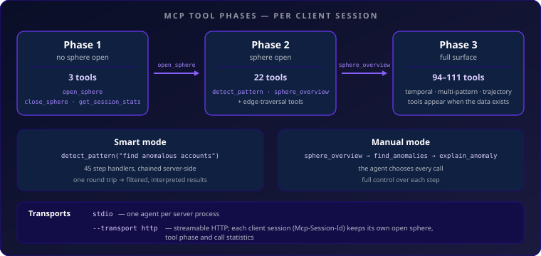

# MCP Server Specification

Full tool parameter reference: [tools.md](tools.md)

## Overview

The server is a thin layer over the hypertopos Python library: each client session holds one open `HyperSession` and its navigator, and every tool translates a call into library calls and the result into compact JSON. It runs over stdio for one local agent or over streamable HTTP with an independent session per connected agent.

**Start:** `hypertopos-mcp` or `python -m hypertopos_mcp.main`
**Config:** the MCP client's server entry (e.g. a project-scoped `.mcp.json`); `HYPERTOPOS_SPHERE_PATH` sets the sphere `open_sphere()` opens without a path; `HYPERTOPOS_MCP_FORMAT` sets the default response format
**Dependencies:** `hypertopos` + `mcp[cli]>=2.3,<3` (MCP Python SDK, `MCPServer`)
**Optional:** the `anthropic` SDK, not a declared dependency — enables the sampling fallback of `detect_pattern` when installed

## Transports and Client Sessions

| Flag | Default | Meaning |
|------|---------|---------|
| `--transport {stdio,http}` | `stdio` | `http` serves the MCP streamable-HTTP transport on `127.0.0.1` |
| `--port` | `8080` | TCP port for HTTP; ignored for stdio |
| `--session-idle-timeout` | `1800` | Seconds an HTTP client session may stay idle before the server ends it and closes its sphere; ignored for stdio |
| `--max-sessions` | `10000` | Most concurrent HTTP client sessions; ignored for stdio |

All server state lives in a client session: the open sphere and its `HyperSession`, the tool phase, the response format, and the call statistics. A request is mapped to its session as follows:

| Request | Session key |
|---------|-------------|
| stdio (or an in-memory client) | `local` — the process's single session |
| HTTP (`--transport http`) with `Mcp-Session-Id` | `http:<id>` |
| HTTP without `Mcp-Session-Id` (the stateless protocol, or a stateless embedding `mcp.streamable_http_app(stateless_http=True)`) with an `X-Hypertopos-Session` header | `header:<value>` |
| HTTP without either | refused with an error naming `X-Hypertopos-Session` |

Clients on the stateless protocol (no session handshake, no `Mcp-Session-Id`) must name their session with `X-Hypertopos-Session`; a client that sends neither is refused at its first session request (capability discovery still answers); clients on the session (initialize) protocol keep their `http:<id>` session. Requests that carry no key are refused rather than served from one shared session, so two clients never share an open sphere. Header-keyed sessions are not counted by `--max-sessions`; they are evicted after `--session-idle-timeout` of inactivity. The `X-Hypertopos-Session` value is the session's only credential: use a random, unguessable value (for example a UUID4). It is not authentication, and two clients that send the same value share one session and its open sphere.

`get_session_stats` reports the caller's `session_key` and `sessions_live` (sessions with a sphere open). Tool calls, resource reads and prompt requests of one session run one at a time; those of different sessions run concurrently. When an HTTP session ends — the client disconnects or the idle timeout passes — the server closes its sphere and forgets it; `close_sphere` also forgets the calling session. `open_sphere(force_reload=True)` reloads modules every session shares, so it is refused while another session has a sphere open.

Per-session state is the whole contract: the HTTP transport adds no authentication or access control of its own, and sessions of the same process share the host's filesystem access.

## Snapshots and Branches

`open_sphere` opens a session pinned to the sphere state current at that moment. Builds, ingests and recalibrations by other processes do not change what its tools return. `get_session_stats` carries a `snapshot` block (`pinned_at`, `stale`, `metadata_changed`, `pinned_versions`, `latest_versions`, `hint`); when `stale` is true, `open_sphere(path)` reopens on the latest state. There is no automatic refresh. A session's own `recalibrate` is visible to it immediately — it records a new calibration epoch, as a rebuild does, so `compare_calibrations` and the drift tools compare before and after it — and promoting a branch from a session open on main moves that session to the promoted state.

A sphere branch is a copy-free what-if workspace. `open_sphere(path, branch=...)` opens a branch (the result's `ref` names it; main otherwise), and every tool then reads the branch. `manage_branch(action=...)` lists, creates, deletes or promotes branches; `recalibrate(pattern_id, branch=..., exclude_keys=[...])` fits on a branch — creating it when absent — without touching main, leaving the excluded entities out of the fit while still scoring them; `compare_branches(pattern_id, branch)` diffs one pattern between the branch and main (or another branch via `other`). Delete and promote are refused for the branch the calling session is open on. Full parameter and return details: [tools.md](tools.md#manage_branch).

## Response Format

Responses are read by an agent, so every repeated byte costs tokens on every call:

- **Compact by default.** `open_sphere(response_format="compact" | "full")` sets the session's format; without it, `HYPERTOPOS_MCP_FORMAT` (read per call), else `compact`. An explicit per-call `summary=` / `verbose=` wins over both.
- **`omitted`.** A compact response that leaves something out — positional `delta` vectors when a labelled form is present, numeric property columns, long recipe lists — carries one `omitted` map naming each dropped part and how to get it (`full_response`).
- **`failed_parts`.** An optional part that could not be loaded is listed as `{part, error}` instead of silently missing.
- **One table per entity list.** Entity properties come in one top-level `properties` table (`{columns, rows}`); properties of edge endpoints in `related_properties`, one table per line.
- **Labelled over positional.** Dimension values are `{dim: value}` maps; shared prose is sent once (`advice_by_warning_type`, `interpretations`) and referenced.
- **Encoding.** Compact JSON with `elapsed_ms` added to every response; floats keep `max(7, integer_digits + 2)` significant digits; non-ASCII text is sent as-is. Every response is strict JSON — non-finite numbers are `null`, numpy scalars are plain JSON numbers and booleans.
- **Schemas and arguments.** Tool input schemas carry no generated `title` keywords. A call with a parameter the tool does not declare fails with the closest valid name ("did you mean 'top_n'?") and the list of valid parameters; tool errors keep their type and message.

## Dynamic Tool Loading



The MCP server uses context-aware tool visibility to minimize token consumption.
Tools are exposed in three phases based on sphere state and capabilities.

Every tool (111 in all) is registered once at startup and assigned a tier in
`_TOOL_TIERS` (`server.py`): `always` (3), `gateway` (2), `edge` (17), `base` (72),
`temporal` (6), `multi_pattern` (8), `trajectory_index` (3). The phase is state of
the client session (stdio has one, HTTP has one per client). The server middleware
filters `tools/list` to the session's visible tools and refuses a `tools/call` of a
tool the session's phase has not unlocked. Each phase change sends
`notifications/tools/list_changed` to the client that caused it.

### Phase 1 — Before `open_sphere`

Only 3 tools are visible (tier: `always`):
- `open_sphere` — load a GDS sphere
- `close_sphere` — close current sphere
- `get_session_stats` — session statistics

All other tools are hidden until a sphere is opened.

### Phase 2 — After `open_sphere` (gateway + edge)

Gateway tools (tier: `gateway`):
- `detect_pattern` — smart meta-tool: LLM plans + executes detection server-side
- `sphere_overview` — population overview, anomaly rates, health checks

Edge table tools (tier: `edge`, 17 tools):
- `find_geometric_path`, `edge_stats`, `entity_flow`, `contagion_score`, `contagion_score_batch`, `degree_velocity`, `investigation_coverage`, `propagate_influence`, `cluster_bridges`, `anomalous_edges`, `find_witness_cohort`, `find_novel_entities`, `find_graph_geometry_tension`, `simulate_edge_removal`, `simulate_dimension_change`, `simulate_counterparty_removal`, `select_minimal_joint_edge_removal`

The agent faces a simple binary choice: use `detect_pattern` for automatic detection,
or call `sphere_overview` to enter manual exploration mode.

### Phase 3 — After `sphere_overview` (manual mode)

Calling `sphere_overview` triggers `_register_manual_tools()` as a side effect,
unlocking the full manual toolset based on the sphere's capabilities:

| Capability | Condition | Tools added |
|------------|-----------|-------------|
| **base** | Always after sphere_overview | 72 tools: navigation, geometry, analysis, chains and motifs, calibration, branches |
| **temporal** | `temporal/` directory exists for any anchor pattern | dive_solid, get_solid, hub_history, find_drifting_entities, compare_time_windows, find_regime_changes |
| **multi_pattern** | 2+ patterns cover same entity (any key type: direct, sibling, event_edge, composite, chain) | cross_pattern_profile, passive_scan, composite_risk, composite_risk_batch, detect_cross_pattern_discrepancy, combine_anomaly_pvalues, classify_detector_consensus, consensus_classification |
| **trajectory_index** | Trajectory ANN index exists in `_gds_meta/trajectory/` | find_drifting_similar, detect_trajectory_anomaly, classify_trajectory |

### Lifecycle

```
Session start → Phase 1 (3 tools: always)
    ↓
open_sphere(path) → Phase 2 (22 tools: always + gateway + edge)
    ↓
  ├─ detect_pattern(query) → smart mode (no extra tools)
  └─ sphere_overview()     → Phase 3 (94-111 tools: full manual mode)
    ↓
close_sphere() → Phase 1 (3 tools)
    ↓
open_sphere(other_path) → Phase 2 (22 tools, different sphere)
```

Phase 3 lists 94 tools on a sphere with only the base capabilities and 111 when it has
temporal data, several patterns per entity line and a trajectory index. Each session
moves through the phases on its own; opening a sphere (or a branch) again starts that
session back at Phase 2.

### open_sphere response

`open_sphere` returns the active ref and response format, a short sphere summary, the
detected capabilities and the tools the session can call at that point (all Phase 2 tools).
Abbreviated:

```json
{
  "status": "open",
  "path": "spheres/my_sphere",
  "ref": "main",
  "response_format": "compact",
  "sphere_id": "my_sphere",
  "name": "My sphere",
  "summary": {"lines": 6, "patterns": 3, "aliases": 0},
  "hint": "Use detect_pattern(query) to find anomalies — describe what to look for. Call sphere_overview() ONLY when you need manual tools for drill-down.",
  "capabilities": {"has_temporal": true, "multi_pattern": true, "has_trajectory_index": false},
  "available_tools": ["close_sphere", "contagion_score", "detect_pattern", "...", "sphere_overview"],
  "patterns": {"account_pattern": {"type": "anchor", "entities": "12,400", "dimensions": ["counterparty", "bank"]}},
  "suggested_queries": ["find accounts with anomalous counterparty in account_pattern"]
}
```

## Operation Modes

After `open_sphere`, two operation modes are available via the gateway (Phase 2):

| Mode | Entry point | Tools visible | Tokens/turn | When to use |
|------|-------------|--------------|-------------|-------------|
| **Smart** | `detect_pattern` | 1 meta-tool (no Phase 3 unlock) | ~400 tk | Agent describes intent in natural language; server plans steps via MCP sampling, executes internally, filters + interprets results |
| **Manual** | `sphere_overview` | 94-111 (unlocked in Phase 3) | ~6-8k tk | Debugging, exploration, custom investigation sequences, follow-up on smart mode findings |

Modes are **not exclusive** — an agent can use `detect_pattern` for overview, then call
`sphere_overview` to unlock granular tools for drill-down.

## Smart Detection (`detect_pattern`)

Single meta-tool that automatically plans and executes detection workflows.

### Execution phases

1. **Planning:** LLM plans execution steps from sphere capabilities (via MCP sampling, 300 tokens, temp 0.1). Falls back to keyword matching → investigation templates when sampling unavailable.
2. **Execution:** Server executes steps internally with dependency resolution (Python calls, zero MCP round-trips). Progress reported via `ctx.report_progress`.
3. **Elicitation:** If >50 candidates found, optionally asks user for stricter threshold (via MCP elicitation, with fallback).
4. **Filtering:** LLM filters false positives from candidates, assigns confidence scores (via sampling, 500 tokens, temp 0.0).
5. **Interpretation:** LLM provides 3-5 sentence summary of findings (via sampling, 400 tokens, temp 0.0).

### Step handlers (45)

| Category | Steps | Capability |
|----------|-------|-----------|
| **Detection** (6) | find_anomalies, detect_trajectory_anomaly, detect_segment_shift, detect_neighbor_contamination, detect_cross_pattern_discrepancy, find_regime_changes | base / trajectory_index / multi_pattern / temporal |
| **Analysis** (9) | find_hubs, find_clusters, find_drifting_entities, find_similar_entities, contrast_populations, check_anomaly_batch, explain_anomaly, cross_pattern_profile, passive_scan | base / temporal / multi_pattern |
| **Composite Risk** (2) | composite_risk, composite_risk_batch | multi_pattern |
| **Aggregation** (1) | aggregate | base |
| **Observability** (5) | sphere_overview, check_alerts, detect_data_quality, anomaly_summary, aggregate_anomalies | base |
| **Temporal** (3) | compare_time_windows, find_drifting_similar, hub_history | temporal / trajectory_index |
| **Network/Fraud** (4) | find_counterparties, extract_chains, find_chains_for_entity, find_common_relations | base |
| **Chains** (5) | find_chains_with_coherent_anomaly, classify_chain_typology, extend_chain, anomaly_propagation_in_chain, trace_root_cause | base |
| **Edges & motifs** (2) | find_high_potential_edges, find_high_potential_motifs | base |
| **Population** (2) | get_centroid_map, attract_boundary | base |
| **Smart-mode exclusive** (6) | assess_false_positive, detect_event_rate_anomaly, detect_hub_anomaly_concentration, detect_composite_subgroup_inflation, detect_collective_drift, detect_temporal_burst | base / multi_pattern / temporal |

The 6 smart-mode exclusive algorithms are NOT available as MCP tools — only reachable
via `detect_pattern`. They provide capabilities impossible in manual mode:

### Multi-step investigation chaining

Steps can depend on prior step results via `depends_on` / `input_key` / `param_target`:

```json
{
  "steps": [
    {"name": "find_anomalies", "params": {"pattern_id": "acct_behavior", "top_n": 5}},
    {"name": "explain_anomaly", "params": {},
     "depends_on": "find_anomalies", "input_key": "top_entities[0].key",
     "param_target": "primary_key"}
  ]
}
```

### Investigation templates (fallback)

When sampling is unavailable, keyword matching selects from pre-defined templates:

| Template | Steps | Triggered by |
|----------|-------|-------------|
| detect_and_explain | find_anomalies → explain_anomaly | "explain why", "root cause" |
| segment_investigation | detect_segment_shift → anomaly_summary | "segment shift", "segment anomal" |
| temporal_investigation | find_drifting_entities → find_regime_changes | "temporal drift", "drift and regime" |
| contamination_analysis | detect_neighbor_contamination → find_hubs | "contamination analysis", "surround" |
| fraud_network | passive_scan | "fraud ring", "fraud network", "aml" |
| population_profile | anomaly_summary → find_clusters | "population profile", "archetype" |
| full_scan | sphere_overview → find_anomalies | (default when no template matches) |

### Investigation hints

`sphere_overview(detail="full")` computes O(1) metadata-based hints per pattern
(temporal availability, cross-pattern opportunities, categorical properties for segment shift).
Hints are cached in `_state["investigation_hints"]` and injected into the planning prompt
to improve step selection even without sampling.

## Sampling Architecture

`_sample_llm` tries two paths in order:

1. **MCP sampling** — `ctx.session.create_message()` with `SamplingMessage`. Requires `clientCapabilities.sampling`. Uses `include_context="thisServer"`, respects `temperature` param.
2. **Anthropic API fallback** — `AsyncAnthropic().messages.create()` with `claude-haiku-4-5-20251001` (hardcoded — update when model retires). Uses `ANTHROPIC_API_KEY` env var. ~$0.003/call.
3. **Keyword fallback** — both LLM paths fail → `detect_pattern` proceeds with keyword matching only. No query planning, no result filtering, no interpretation. The agent gets raw step outputs without LLM-generated summaries.

Negative caching: if `anthropic` package is not installed, the import failure is cached
(sentinel `_anthropic_client = False`) so subsequent calls skip the import attempt.

### Internal modules

- **`enrichment.py`** — shared response enrichment helper. Adds `temporal_hint`, `calibration_stale`, `continuous_mode_note`, `degenerate_warning` to tool responses. Used by navigation and geometry tools.

## MCP Resources

Cacheable sphere metadata — zero token cost on repeated reads.

| URI | Content | Available |
|-----|---------|-----------|
| `sphere://info` | Sphere schema: lines, patterns, aliases | After `open_sphere` |
| `sphere://capabilities` | Detected capabilities dict | After `open_sphere` |

Both resources describe the sphere the calling client session has open.

## MCP Prompts

User-triggered investigation workflows (slash commands):

| Prompt | Parameters | Workflow |
|--------|-----------|----------|
| `/investigate` | `entity_key`, `line_id` | goto → get_polygon → explain_anomaly → find_similar → dive_solid |
| `/scan` | `pattern_id` (optional) | sphere_overview → find_anomalies → detect_segment_shift → find_hubs → find_regime_changes |
| `/compare` | `key_a`, `key_b`, `pattern_id` | get_polygon × 2 → compare_entities → find_common_relations → contrast_populations |

## MCP Elicitation

Mid-execution user input for domain-specific thresholds. Triggered when `detect_pattern`
finds >50 candidates. Asks user for stricter threshold. Falls back silently when client
doesn't support elicitation (`hasattr(ctx, "elicit")` + `try/except`).

## MCP Primitives Summary

| Primitive | Usage | Fallback |
|-----------|-------|----------|
| **Sampling** | LLM plans + filters + interprets via `session.create_message` | Anthropic API → keyword fallback |
| **Resources** | `sphere://info`, `sphere://capabilities` — cached metadata | `get_sphere_info()` tool call |
| **Prompts** | `/investigate`, `/scan`, `/compare` — user workflows | Manual tool calls |
| **Elicitation** | Threshold refinement on large result sets | Proceed with all results |
| **Progress** | `ctx.report_progress(i, total)` during step execution | Silently skip |
| **Logging** | `ctx.info(step_name)` for structured diagnostics | No-op |
| **Instructions** | `MCPServer(instructions=...)` — mentions `detect_pattern` as entry point | N/A |
| **Tool Annotations** | `read_only_hint=True` on 106 read-only tools; `destructive_hint=True` on `recalibrate` and `manage_branch` | Host assumes worst case |

## Token Cost per Phase

| Phase | Tools visible | Estimated token cost |
|-------|:------------:|---------------------|
| Phase 1 — before open_sphere | 3 | ~200 tk |
| Phase 2 — after open_sphere | 22 | ~850 tk |
| Phase 3 — full sphere (all capabilities) | ~111 | ~7k tk (filtered + trimmed docstrings) |
| Phase 3 — simple sphere (base only) | ~94 | ~5k tk |

Without 3-phase loading, all 111 tool schemas would be in context from the start (~22k tk).

## Adding New Tools

When adding a new MCP tool:
1. Register with `@mcp.tool(annotations=ToolAnnotations(read_only_hint=True))` (`destructive_hint=True` for tools that write sphere state) and `@timed`, returning a JSON string shaped by the [response format](#response-format) rules
2. Add entry to `_TOOL_TIERS` in `server.py` (`always` / `gateway` / `edge` / `base` / `temporal` / `multi_pattern` / `trajectory_index`)
3. Add step handler in `smart.py` (`_step_<name>`) + entry in `_STEP_HANDLERS` + `_STEP_CAPABILITIES`
4. Add keyword tuple in `_kw` dict (or add to `CHAINING_ONLY` if step is only for multi-step chains)
5. If new capability needed, add detection logic to `_detect_capabilities()`
6. Run `test_smart_coverage.py` + `test_dynamic_tools.py` — catches missing entries

## Behavioral Notes

### Anomaly counting consistency

All tools that count anomalies (`sphere_overview`, `anomaly_summary`, `find_anomalies`,
`aggregate_anomalies`, `detect_data_quality_issues`, `compare_branches`) use the same rule:

- **Calibrated patterns** (non-empty `score_dims`): count entities with `is_anomaly = true` — the stored alarm-budget flag set by the conformal score at build / recalibration time. `sphere_overview` reports `anomaly_rate_source = "is_anomaly"` for these patterns.
- **Other patterns**: live filter `delta_norm >= theta_norm` on geometry. `sphere_overview` reports `anomaly_rate_source = "delta_norm_scan"`. Patterns with `group_by_property` use the global theta here, consistent with `anomaly_summary` and `find_anomalies`.

The two rules share a single implementation path that all of the tools above delegate to. Mixing them (e.g. reading `is_anomaly` on an uncalibrated pattern that uses per-group thresholds) would give inconsistent counts — the split is intentional.

### passive_scan source types

`passive_scan` dispatches sources by `type` field: `geometry` (default), `borderline`,
`points`, `compound`. See [tools.md](tools.md#passive_scan) for JSON schema.

### find_similar_entities degenerate warning

When >50% of ANN neighbors have `distance=0` (common on patterns with high `inactive_ratio`),
the response includes `degenerate_warning` and `population_diversity_note`. Smart mode
step handler also surfaces this warning.
